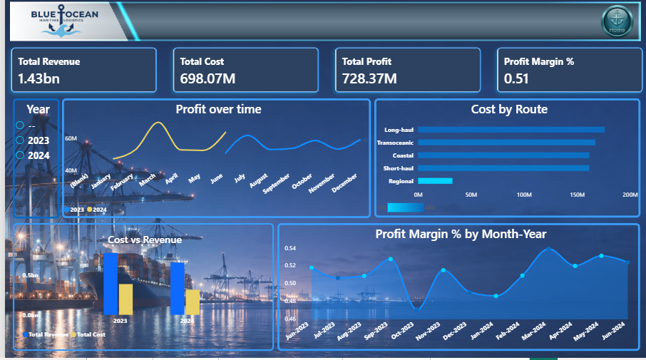

# 🚢 Maritime Logistics & Container Shipping Analytics

## 📋 Business Context & Problem Statement
In the global maritime shipping industry, operational efficiency, timely transit, and cost optimization are critical. Management needed deep visibility into container shipping performance, route bottlenecks, and transit time delays to make informed, data-driven operational adjustments.

---

## 🛠️ Tools & Technologies Used
- **Data Preparation & Transformation:** Microsoft Excel
- **Data Visualization & Dashboarding:** Microsoft Power BI (Custom DAX, Navigation Buttons, UX Layout Design)
- **Data Storytelling & Business Analysis:** KPI Tracking, Trend Analysis, and Executive Reporting.

---

## 🔍 Key Performance Indicators (KPIs) & Insights
- **Transit Time Evaluation:** Tracked average shipping durations across major global trade routes to identify recurring delays.
- **Container Flow Bottlenecks:** Highlighted specific ports and shipping lanes causing operational friction.
- **Operational Efficiency:** Provided actionable recommendations to reduce shipping times and optimize overall logistics costs.

---

## 📊 Dashboard Preview & Screenshots

## 📊 Dashboard Preview & Screenshots

### 1. Overview Page

### 2. Operational Performance

### 3. Timing Analysis

### 4. Navigation Page

---

## 📂 Project Files
- **Power BI Report:** [Download Blue ocean .pbix File](./Blue%20ocean.pbix)
